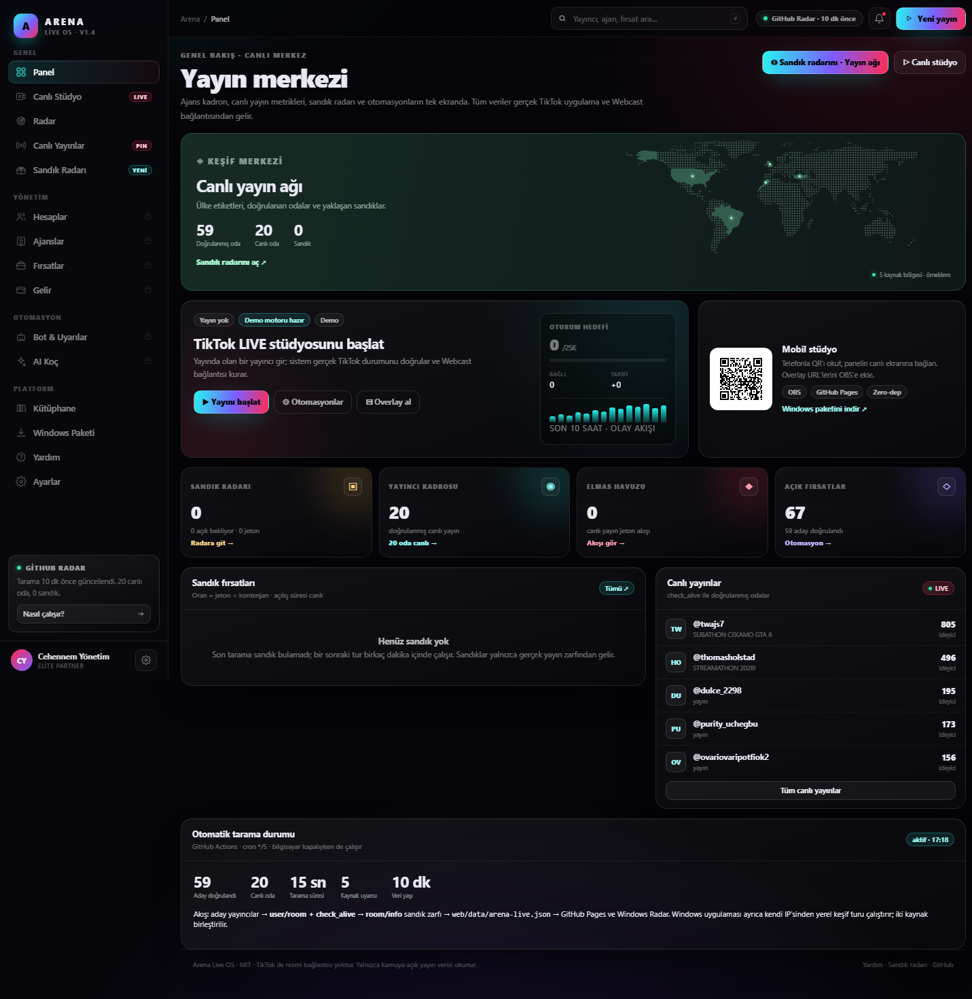
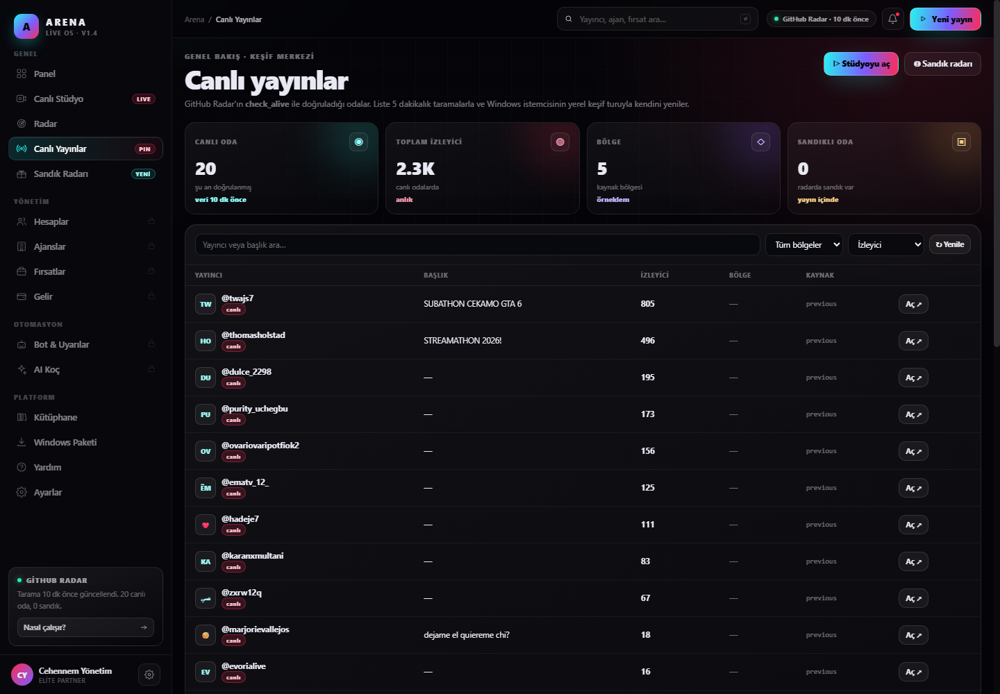
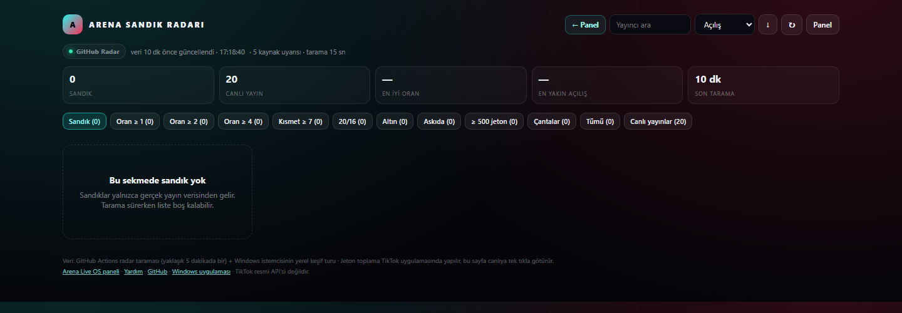

# Arena Live OS

TikTok LIVE ajansları için **sürekli çalışan radar**, canlı yayın ağı ve Windows bildirim uygulaması.
Panel kapalıyken bile GitHub Actions tarar; sonuç GitHub Pages'te yayınlanır ve Windows istemcisi aynı veriyi saniyeler içinde gösterir.

[](https://cehennemgibiyim.github.io/ArenaSag/)
[](https://github.com/CehennemGibiyim/ArenaSag/releases/latest/download/ArenaRadar-Setup.exe)
[](https://github.com/CehennemGibiyim/ArenaSag/actions)

> **Gerçek veri kuralı:** Sandık, jeton, kontenjan ve izleyici bilgisi yalnızca TikTok Webcast yanıtında açıkça göründüğünde gösterilir. Tahmin veya demo verisi üretilmez; veri yoksa liste boş kalır ve nedeni yazılır.

## Ekran görüntüleri

| Yayın merkezi | Canlı yayınlar |
| --- | --- |
|  |  |
| Keşif merkezi haritası, canlı stüdyo, QR erişimi ve dört istatistik kartı. | Arama, bölge filtresi, izleyici sayısı ve sandıklı odalar. |



> Ekran görüntüleri bu depodaki gerçek panelden alınmıştır. Tarama anında sandık yoksa kartlar boş durum metni gösterir.

---

## 30 saniyede başla

### 1. Web paneli (kurulum yok)

- Panel: **https://cehennemgibiyim.github.io/ArenaSag/**
- Sandık radarı: **https://cehennemgibiyim.github.io/ArenaSag/sandik.html**
- Yardım: **https://cehennemgibiyim.github.io/ArenaSag/yardim.html**

Panel herkese açıktır; veri GitHub Actions taramasından gelir. Telefon, tablet veya başka bir bilgisayardan açabilirsin.

### 2. Windows uygulaması (bildirimli)

1. [**ArenaRadar-Setup.exe**](https://github.com/CehennemGibiyim/ArenaSag/releases/latest/download/ArenaRadar-Setup.exe) indir.
2. Çalıştır — yönetici izni gerekmez, `%LOCALAPPDATA%\Programs\Arena Radar` altına kurulur.
3. Uygulama açılır; masaüstü ve başlangıç kısayolu oluşur.
4. İlk açılışta yerel keşif turu başlar; panel `http://127.0.0.1:4817` adresinde açılır.

Windows SmartScreen "bilinmeyen yayıncı" uyarısı verirse **Daha fazla bilgi → Yine de çalıştır**.
Kurulum paketi imzasızdır; kaynak kod bu depodadır.

### 3. GitHub deposunu kendi hesabına al

1. Depoyu fork'la veya kopyala.
2. **Settings → Pages → Build and deployment → GitHub Actions**.
3. **Settings → Actions → General → Workflow permissions → Read and write permissions**.
4. **Actions → Arena Radar Scan → Run workflow** ile ilk turu başlat.
5. `https://KULLANICI.github.io/ArenaSag/` adresini aç.

> Zamanlanmış işler GitHub'da en kısa 5 dakikada bir çalışır. Depo 60 gün hareketsiz kalırsa GitHub cron'u durdurur; her push veya manuel çalıştırma sayacı sıfırlar. Windows istemcisi bundan etkilenmez, kendi keşif turunu çalıştırmaya devam eder.

---

## Tam otomatik tarama nasıl çalışır?

İki bağımsız kaynak sürekli tarar ve sonuçlar birleştirilir. Kullanıcı hiçbir taramayı elle başlatmak zorunda değildir.

```
GitHub Actions · cron */5
  ├─ aday toplama: Tik.Tools, TikWM bölge örnekleri, yayıncı dizini, önceki odalar
  ├─ doğrulama: user/room → check_alive
  ├─ sandık zarfı: room/info → envelopeInfo / envelope_list
  └─ web/data/arena-live.json + version.json → commit
                                                ├─ GitHub Pages (web paneli)
                                                └─ Windows Radar (5 sn'de bir ham veri)

Windows istemcisi · paket içindeki aynı tarayıcı
  ├─ kendi IP'sinden yerel keşif turu (varsayılan 5 dk)
  ├─ bilinen odaların zarfını 20 sn'de bir yoklama
  └─ iki kaynağın en yenisini birleştirip gösterir
```

- **GitHub taraması** bilgisayar kapalıyken de çalışır.
- **Yerel keşif turu** GitHub cron'unu beklemez; bölgesel odaları ve sandıkları kendi bağlantından yakalar.
- **Sandık bildirimi** açılıştan önce (varsayılan 180 sn pencere, oran ≥ 7) Windows balon bildirimi ve ses üretir.
- **Değişiklik algılama** ham veri 5 saniyede bir, `version.json` 60 saniyede bir denetlenir.
- **Otomatik jeton toplama TikTok tarafından sunulmaz.** Sistem sandığı zamanında gösterir, bildirir ve canlıya tek tıkla götürür; jetonu sen toplarsın.

Ayrıntılı mimari: [docs/GITHUB-RADAR.md](docs/GITHUB-RADAR.md)

---

## Panel sayfaları

| Sayfa | Adres | Ne yapar |
| --- | --- | --- |
| Yayın merkezi | `/` | Keşif merkezi haritası, canlı stüdyo, QR, 4 istatistik kartı, sandık ve yayın özeti |
| Canlı yayınlar | `/yayinlar.html` | Doğrulanmış odalar, arama, bölge filtresi, canlıya tek tık |
| Sandık radarı | `/sandik.html` | Oran, jeton, kontenjan, açılışa kalan süre, 12 sekme, filtreler |
| Yardım | `/yardim.html` | Resimli kurulum, otomatik tarama, SSS |
| Ayarlar | `/ayarlar.html` | Yenileme sıklığı, veri kaynağı, bildirim izni, tanılama |
| Overlay | `/overlay.html` | OBS browser source widget'ları |

**Hesaplar, Ajanslar, Fırsatlar, Gelir, Bot & Uyarılar ve AI Koç** bağlantıları tam panele gider; hiçbir modül kilitli değildir. Tam panel varsayılan olarak `http://localhost:3000` adresinde çalışır, adres Ayarlar → Tam panel adresi bölümünden değiştirilebilir.

## Öne çıkan sistemler

| Sistem | Açıklama |
| --- | --- |
| **GitHub Radar** | Panel/oturum olmadan ~5 dakikada bir tarama; canlı yayınlar ve sandık zarfları JSON olarak yayınlanır |
| **Windows Radar** | GitHub verisini 5 saniyede bir çeker; yerel keşif turu çalıştırır; sandık açılmadan bildirir |
| **Canlı Stüdyo** | Chat, hediye, beğeni, takip olayları; hedef barı ve oturum geçmişi (tam panel) |
| **Sandık Radarı** | Jeton ÷ kontenjan oranı, 16 hazır sekme, 9 sıralama anahtarı, QR ile telefondan katılma |
| **Canlı Yayınlar** | Keşfedilen yayıncılar kalıcı; sabitleme, izleyici/sandık/en iyi oran takibi (tam panel) |
| **Eşzamanlı tarayıcı** | Worker pool ile paralel oda dinleme; doğrulanan odalar kalıcı sıraya eklenir (tam panel) |
| **Bölgesel keşif** | Desteklenen pazarlar dönüşümlü örneklenir; aday ve doğrulanmış oda sayıları ayrıdır |
| **Yerel Agent** | Kendi bilgisayarında çalışan paralel toplayıcı; sandık + jeton akışını panele yazar |
| **Chat Botu / Uyarılar** | Tetikleyici-yanıt kuralları, hediye eşik alarmları, overlay/ses/Telegram aksiyonları |
| **Overlay Sunucusu** | OBS için hedef barı, top gifter, sohbet, alert ve stats widget'ları |
| **Gelir / Ajanslar / Fırsatlar** | Elmas→TL/USD, komisyon, tahsilat; tam CRUD ve CSV dışa aktarım (tam panel) |
| **AI Koç** | Yayın senaryosu, hediye stratejisi ve marka teklifi; OpenAI anahtarı opsiyonel |

## Yerel çalıştırma

### Statik panel + radar

```bash
# bağımlılık gerekmez
node scripts/radar-publish.mjs          # web/data/arena-live.json üretir
python3 -m http.server 3000 --directory web
# http://localhost:3000
```

### Windows istemcisi

```bash
node desktop/main.mjs                   # http://127.0.0.1:4817
node desktop/main.mjs --silent          # tarayıcı açmadan arka planda
```

Paket üretimi:

```bash
node scripts/build-radar-package.mjs --node-exe /yol/node.exe
makensis scripts/installer.nsi
```

### Tam panel (Next.js + PostgreSQL)

```bash
npm ci
cp .env.example .env                    # DATABASE_URL düzenle
npx drizzle-kit push
npm run build && npm run start
curl -X POST http://localhost:3000/api/demo/seed
```

Ayrıntı: [docs/WINDOWS-KURULUM.md](docs/WINDOWS-KURULUM.md)

## Ayarlar

Windows uygulamasında **Ayarlar**:

| Ayar | Varsayılan | Açıklama |
| --- | --- | --- |
| `pollSeconds` | 5 | GitHub ham verisinin yoklanma sıklığı |
| `alertRatio` | 7 | Bildirim için en düşük jeton/kontenjan oranı |
| `alertSeconds` | 180 | Sandık açılışına kalan bildirim penceresi |
| `roomScanSeconds` | 20 | Bilinen odaların zarf yoklaması |
| `roomScanLimit` | 8 | Her turda yoklanacak oda |
| `discoverMinutes` | 5 | Yerel keşif turunun sıklığı |
| `discoverChecks` | 60 | Keşifte doğrulanacak aday sayısı |
| `discoverRooms` | 25 | Keşifte sandık için sorgulanacak oda |
| `notifyDesktop`, `sound`, `autoUpdate` | açık | Bildirim, ses ve otomatik güncelleme |

Ayarlar `%LOCALAPPDATA%\ArenaRadar\config.json` dosyasında tutulur ve güncellemelerde korunur.
Web paneli ayarları (`/ayarlar.html`) yalnızca tarayıcıda `localStorage`'a yazılır.

## Dokümantasyon

- [GitHub Radar mimarisi ve veri sözleşmesi](docs/GITHUB-RADAR.md)
- [Windows kurulum rehberi](docs/WINDOWS-KURULUM.md)
- [Web kütüphanesi ve overlay](docs/WEB-KUTUPHANE.md)
- [Keşif kapsamı ve dinleme bütçeleri](docs/RADAR-DINLEME.md)
- [Panel içi resimli yardım](https://cehennemgibiyim.github.io/ArenaSag/yardim.html)

## Sınırlar

- Ücretsiz hiçbir kaynak dünyadaki **tüm** yayınların listesini vermez. Tarama; açık örnekleri, bölgesel trendleri ve önceki doğrulanmış odaları kullanır.
- TikTok uçları veri merkezi IP'lerini zaman zaman sınırlayabilir. Betik elindeki doğrulanmış veriyi korur ve `errors` alanına yazar.
- GitHub Pages bazı kurumsal ağlarda engellenebilir; Windows uygulaması önce ham GitHub adresini dener.
- TikTok LIVE verisi resmi olmayan Webcast protokolünden okunur. `tiktok-live-connector` MIT lisanslıdır ve TikTok ile bağlantılı değildir. Yalnızca kamuya açık yayınları okumak için kullanın.
- Otomatik jeton toplama TikTok tarafından sunulmaz; bu proje yalnızca zamanında gösterim ve tek tıkla erişim sağlar.

## Lisans

MIT. TikTok ile resmi bağlantısı yoktur.
